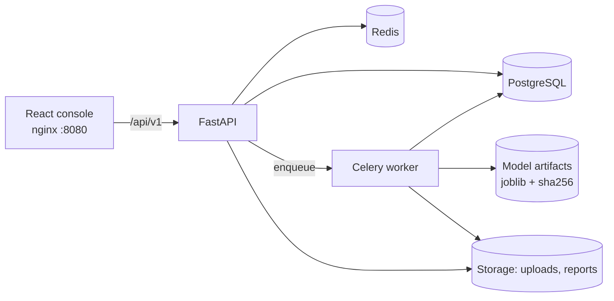
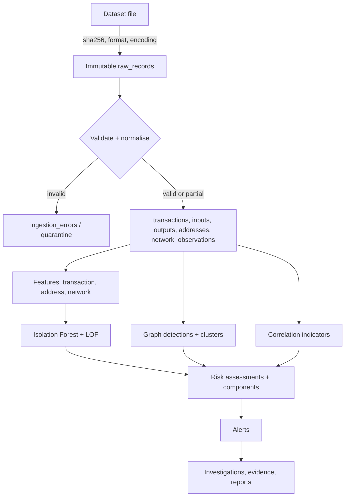
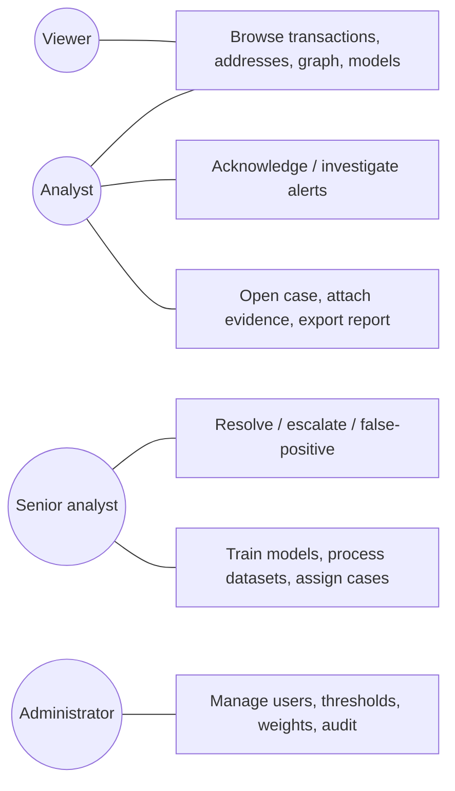

# System architecture

Modular monolith with clear package boundaries so modules can be extracted later.

## Package map (`backend/app`)
`api/v1` routers → `services` → models; `ingestion` (parsers, normaliser, address codec, resumable service, synthetic generator);
`analytics` (loader, point-in-time features); `intelligence` (network correlation); `graph` (patterns, clustering, DB-backed queries);
`ml` (engine); `alerts` (rules, engine, workflow); `investigations`; `reports`; `workers` (Celery); `core` (config, security, RBAC, errors, hashing, middleware).

## Data flow

Layers are never mixed in storage: **observed facts** (canonical tables), **derived features**, **heuristic indicators**
(`graph_detections`, `correlation_indicators`, `address_clusters`), **ML outputs** (`anomaly_predictions`) and **analyst decisions**
(alert/case status, notes, cluster review, evidence).

## Pipeline execution
`POST /ingestion/datasets/{id}/process` creates one job per file and enqueues a Celery task (`BITGUARD_CELERY_EAGER=true` runs inline for tests).
The task ingests in batches (checkpoint committed in the same DB transaction as the batch), then runs stages
`analytics → ml → risk → alerts`. All stages are idempotent and recompute derived tables from canonical data.

## Use cases

Roles inherit upwards (viewer ⊂ analyst ⊂ senior analyst ⊂ administrator); the explicit permission matrix is in [security.md](../security/security.md).
