# Database design

PostgreSQL 16, SQLAlchemy 2.0, Alembic migrations (`backend/migrations`). Generated by `scripts/gen_docs.py`.

Rules: monetary values are `BIGINT` satoshis; all timestamps are UTC `timestamptz`; `txid`, address, time, IP, ASN, block height, alert status and case FKs are indexed; duplicate ingestion is prevented by unique constraints (`transactions.txid`, `raw_records(dataset_file_id, record_index)`, `network_observations.obs_hash`, `dataset_files(dataset_id, sha256)`). `audit_logs`, `raw_records` and `evidence_records` are append-only (trigger raises on UPDATE/DELETE). Partitioning is intentionally not used: measured data volume does not justify it.

```mermaid
erDiagram
    users ||--o{ address_clusters : "reviewed_by"
    users ||--o{ datasets : "created_by"
    users ||--o{ investigations : "assigned_to"
    users ||--o{ investigations : "created_by"
    users ||--o{ model_versions : "trained_by"
    users ||--o{ refresh_tokens : "user_id"
    roles ||--o{ role_permissions : "role_id"
    permissions ||--o{ role_permissions : "permission_id"
    users ||--o{ system_config : "updated_by"
    roles ||--o{ user_roles : "role_id"
    users ||--o{ user_roles : "user_id"
    model_versions ||--o{ anomaly_predictions : "model_version_id"
    address_clusters ||--o{ cluster_memberships : "cluster_id"
    datasets ||--o{ dataset_files : "dataset_id"
    users ||--o{ investigation_addresses : "added_by"
    investigations ||--o{ investigation_addresses : "investigation_id"
    users ||--o{ investigation_notes : "author_id"
    investigations ||--o{ investigation_notes : "investigation_id"
    users ||--o{ investigation_transactions : "added_by"
    investigations ||--o{ investigation_transactions : "investigation_id"
    model_versions ||--o{ model_evaluations : "model_version_id"
    users ||--o{ report_records : "generated_by"
    investigations ||--o{ report_records : "investigation_id"
    model_versions ||--o{ risk_assessments : "model_version_id"
    risk_assessments ||--o{ risk_assessments : "supersedes_id"
    model_versions ||--o{ alerts : "model_version_id"
    risk_assessments ||--o{ alerts : "risk_assessment_id"
    users ||--o{ alerts : "assigned_to"
    users ||--o{ ingestion_jobs : "triggered_by"
    dataset_files ||--o{ ingestion_jobs : "dataset_file_id"
    datasets ||--o{ ingestion_jobs : "dataset_id"
    datasets ||--o{ raw_records : "dataset_id"
    dataset_files ||--o{ raw_records : "dataset_file_id"
    risk_assessments ||--o{ risk_components : "assessment_id"
    alerts ||--o{ alert_links : "related_alert_id"
    alerts ||--o{ alert_links : "alert_id"
    alerts ||--o{ alert_notes : "alert_id"
    users ||--o{ alert_notes : "author_id"
    raw_records ||--o{ evidence_records : "raw_record_id"
    users ||--o{ evidence_records : "added_by"
    investigations ||--o{ evidence_records : "investigation_id"
    ingestion_jobs ||--o{ ingestion_checkpoints : "job_id"
    ingestion_jobs ||--o{ ingestion_errors : "job_id"
    dataset_files ||--o{ ingestion_errors : "dataset_file_id"
    raw_records ||--o{ ingestion_errors : "raw_record_id"
    alerts ||--o{ investigation_alerts : "alert_id"
    users ||--o{ investigation_alerts : "added_by"
    investigations ||--o{ investigation_alerts : "investigation_id"
    raw_records ||--o{ transactions : "source_raw_record_id"
    datasets ||--o{ transactions : "dataset_id"
    transactions ||--o{ network_observations : "transaction_id"
    raw_records ||--o{ network_observations : "source_raw_record_id"
    datasets ||--o{ network_observations : "dataset_id"
    transactions ||--o{ transaction_features : "transaction_id"
    transactions ||--o{ transaction_inputs : "transaction_id"
    transactions ||--o{ transaction_outputs : "transaction_id"
    network_observations ||--o{ investigation_observations : "observation_id"
    investigations ||--o{ investigation_observations : "investigation_id"
    users ||--o{ investigation_observations : "added_by"
```

## Tables

### `address_features`

| Column | Type | Null | Key |
|---|---|---|---|
| id | BIGINT | no | PK |
| address | VARCHAR(100) | no |  |
| as_of | DATETIME | no |  |
| schema_version | VARCHAR(16) | no |  |
| features | JSONB | no |  |
| computed_at | DATETIME | no |  |

Indexes: `ix_address_features_address`, `ix_address_features_as_of`

### `addresses`

| Column | Type | Null | Key |
|---|---|---|---|
| address | VARCHAR(100) | no | PK |
| address_type | VARCHAR(16) | no |  |
| network | VARCHAR(16) | no |  |
| first_seen_at | DATETIME | no |  |
| last_seen_at | DATETIME | no |  |

### `alert_rules`

| Column | Type | Null | Key |
|---|---|---|---|
| id | INTEGER | no | PK |
| code | VARCHAR(64) | no | UQ |
| category | VARCHAR(64) | no |  |
| description | TEXT | no |  |
| enabled | BOOLEAN | no |  |
| thresholds | JSONB | no |  |
| version | INTEGER | no |  |
| created_at | DATETIME | no |  |
| updated_at | DATETIME | no |  |

### `analysis_runs`

| Column | Type | Null | Key |
|---|---|---|---|
| id | VARCHAR(64) | no | PK |
| stage | VARCHAR(32) | no |  |
| status | VARCHAR(16) | no |  |
| params | JSONB | no |  |
| stats | JSONB | no |  |
| started_at | DATETIME | no |  |
| finished_at | DATETIME | yes |  |

Indexes: `ix_analysis_runs_stage`

### `asn_entities`

| Column | Type | Null | Key |
|---|---|---|---|
| asn | BIGINT | no | PK |
| first_seen_at | DATETIME | no |  |
| last_seen_at | DATETIME | no |  |

### `audit_logs`

| Column | Type | Null | Key |
|---|---|---|---|
| id | BIGINT | no | PK |
| occurred_at | DATETIME | no |  |
| actor_id | UUID | yes |  |
| actor_email | VARCHAR(255) | yes |  |
| action | VARCHAR(96) | no |  |
| entity_type | VARCHAR(64) | no |  |
| entity_id | VARCHAR(128) | yes |  |
| request_id | VARCHAR(64) | yes |  |
| details | JSONB | no |  |
| prev_hash | VARCHAR(64) | yes |  |
| entry_hash | VARCHAR(64) | no | UQ |
| seq | BIGINT | no | UQ |
| note | TEXT | yes |  |

Indexes: `ix_audit_logs_action`, `ix_audit_logs_actor_id`, `ix_audit_logs_entity_id`, `ix_audit_logs_entity_type`, `ix_audit_logs_occurred_at`

### `correlation_indicators`

| Column | Type | Null | Key |
|---|---|---|---|
| id | BIGINT | no | PK |
| indicator_type | VARCHAR(48) | no |  |
| entity_type | VARCHAR(16) | no |  |
| entity_key | VARCHAR(100) | no |  |
| window_start | DATETIME | no |  |
| window_end | DATETIME | no |  |
| strength | FLOAT | no |  |
| confidence | FLOAT | no |  |
| metrics | JSONB | no |  |
| evidence_refs | JSONB | no |  |
| limitations | TEXT | no |  |
| run_id | VARCHAR(64) | no |  |
| created_at | DATETIME | no |  |

Indexes: `ix_corr_entity`, `ix_correlation_indicators_indicator_type`, `ix_correlation_indicators_run_id`

### `dead_letters`

| Column | Type | Null | Key |
|---|---|---|---|
| id | BIGINT | no | PK |
| job_id | UUID | yes |  |
| stage | VARCHAR(32) | no |  |
| record_index | INTEGER | yes |  |
| payload | JSONB | no |  |
| error | TEXT | no |  |
| attempts | INTEGER | no |  |
| created_at | DATETIME | no |  |

Indexes: `ix_dead_letters_job_id`

### `evaluation_labels`

| Column | Type | Null | Key |
|---|---|---|---|
| id | BIGINT | no | PK |
| entity_type | VARCHAR(16) | no |  |
| entity_key | VARCHAR(100) | no |  |
| label | VARCHAR(16) | no |  |
| pattern | VARCHAR(48) | yes |  |
| source | VARCHAR(32) | no |  |
| dataset_id | UUID | yes |  |
| created_by | UUID | yes |  |
| created_at | DATETIME | no |  |

Indexes: `ix_evaluation_labels_entity_key`

### `geo_entities`

| Column | Type | Null | Key |
|---|---|---|---|
| country_code | VARCHAR(2) | no | PK |
| first_seen_at | DATETIME | no |  |
| last_seen_at | DATETIME | no |  |

### `graph_detections`

| Column | Type | Null | Key |
|---|---|---|---|
| id | BIGINT | no | PK |
| pattern | VARCHAR(48) | no |  |
| anchor_txid | VARCHAR(64) | yes |  |
| txids | JSONB | no |  |
| addresses | JSONB | no |  |
| metrics | JSONB | no |  |
| confidence | FLOAT | no |  |
| explanation | TEXT | no |  |
| limitations | TEXT | no |  |
| window_start | DATETIME | yes |  |
| window_end | DATETIME | yes |  |
| run_id | VARCHAR(64) | no |  |
| created_at | DATETIME | no |  |

Indexes: `ix_graph_detections_anchor_txid`, `ix_graph_detections_pattern`, `ix_graph_detections_run_id`

### `ip_entities`

| Column | Type | Null | Key |
|---|---|---|---|
| ip | INET | no | PK |
| version | INTEGER | no |  |
| is_private | BOOLEAN | no |  |
| first_seen_at | DATETIME | no |  |
| last_seen_at | DATETIME | no |  |

### `network_features`

| Column | Type | Null | Key |
|---|---|---|---|
| id | BIGINT | no | PK |
| entity_type | VARCHAR(16) | no |  |
| entity_key | VARCHAR(64) | no |  |
| as_of | DATETIME | no |  |
| schema_version | VARCHAR(16) | no |  |
| features | JSONB | no |  |
| computed_at | DATETIME | no |  |

Indexes: `ix_network_features_entity_key`

### `permissions`

| Column | Type | Null | Key |
|---|---|---|---|
| id | INTEGER | no | PK |
| code | VARCHAR(64) | no | UQ |
| description | VARCHAR(255) | no |  |

### `roles`

| Column | Type | Null | Key |
|---|---|---|---|
| id | INTEGER | no | PK |
| name | VARCHAR(64) | no | UQ |
| description | VARCHAR(255) | no |  |

### `users`

| Column | Type | Null | Key |
|---|---|---|---|
| id | UUID | no | PK |
| email | VARCHAR(255) | no | UQ |
| full_name | VARCHAR(255) | no |  |
| password_hash | VARCHAR(255) | no |  |
| is_active | BOOLEAN | no |  |
| mfa_secret | VARCHAR(64) | yes |  |
| mfa_enabled | BOOLEAN | no |  |
| failed_logins | INTEGER | no |  |
| locked_until | DATETIME | yes |  |
| last_login_at | DATETIME | yes |  |
| created_at | DATETIME | no |  |
| updated_at | DATETIME | no |  |

Indexes: `ix_users_email`

### `address_clusters`

| Column | Type | Null | Key |
|---|---|---|---|
| id | UUID | no | PK |
| method | VARCHAR(48) | no |  |
| confidence | FLOAT | no |  |
| size | INTEGER | no |  |
| evidence | JSONB | no |  |
| limitations | TEXT | no |  |
| review_status | VARCHAR(32) | no |  |
| reviewed_by | UUID | yes | FK |
| run_id | VARCHAR(64) | no |  |
| created_at | DATETIME | no |  |
| updated_at | DATETIME | no |  |

Indexes: `ix_address_clusters_method`, `ix_address_clusters_run_id`

### `datasets`

| Column | Type | Null | Key |
|---|---|---|---|
| id | UUID | no | PK |
| name | VARCHAR(255) | no |  |
| description | TEXT | yes |  |
| provenance | VARCHAR(32) | no |  |
| created_by | UUID | yes | FK |
| status | VARCHAR(32) | no |  |
| created_at | DATETIME | no |  |
| updated_at | DATETIME | no |  |

### `investigations`

| Column | Type | Null | Key |
|---|---|---|---|
| id | UUID | no | PK |
| case_number | VARCHAR(32) | no | UQ |
| title | VARCHAR(255) | no |  |
| summary | TEXT | yes |  |
| status | VARCHAR(32) | no |  |
| priority | VARCHAR(32) | no |  |
| created_by | UUID | no | FK |
| assigned_to | UUID | yes | FK |
| analyst_decision | TEXT | yes |  |
| closed_at | DATETIME | yes |  |
| created_at | DATETIME | no |  |
| updated_at | DATETIME | no |  |

Indexes: `ix_investigations_assigned_to`, `ix_investigations_priority`, `ix_investigations_status`

### `model_versions`

| Column | Type | Null | Key |
|---|---|---|---|
| id | UUID | no | PK |
| name | VARCHAR(64) | no |  |
| algorithm | VARCHAR(48) | no |  |
| version | VARCHAR(32) | no |  |
| entity_type | VARCHAR(16) | no |  |
| params | JSONB | no |  |
| feature_schema | JSONB | no |  |
| training_snapshot | JSONB | no |  |
| artifact_path | VARCHAR(1024) | no |  |
| artifact_sha256 | VARCHAR(64) | no |  |
| random_seed | INTEGER | no |  |
| is_active | BOOLEAN | no |  |
| trained_by | UUID | yes | FK |
| trained_at | DATETIME | no |  |
| notes | TEXT | yes |  |

Indexes: `ix_model_versions_is_active`, `ix_model_versions_name`

### `refresh_tokens`

| Column | Type | Null | Key |
|---|---|---|---|
| jti | VARCHAR(64) | no | PK |
| user_id | UUID | no | FK |
| issued_at | DATETIME | no |  |
| expires_at | DATETIME | no |  |
| revoked_at | DATETIME | yes |  |
| replaced_by | VARCHAR(64) | yes |  |

Indexes: `ix_refresh_tokens_user_id`

### `role_permissions`

| Column | Type | Null | Key |
|---|---|---|---|
| role_id | INTEGER | no | PK |
| permission_id | INTEGER | no | PK |

### `system_config`

| Column | Type | Null | Key |
|---|---|---|---|
| id | INTEGER | no | PK |
| key | VARCHAR(64) | no |  |
| value | JSONB | no |  |
| version | INTEGER | no |  |
| updated_by | UUID | yes | FK |
| created_at | DATETIME | no |  |
| updated_at | DATETIME | no |  |

### `user_roles`

| Column | Type | Null | Key |
|---|---|---|---|
| user_id | UUID | no | PK |
| role_id | INTEGER | no | PK |

### `anomaly_predictions`

| Column | Type | Null | Key |
|---|---|---|---|
| id | BIGINT | no | PK |
| model_version_id | UUID | no | FK |
| entity_type | VARCHAR(16) | no |  |
| entity_key | VARCHAR(100) | no |  |
| raw_score | FLOAT | no |  |
| anomaly_score | FLOAT | no |  |
| is_outlier | BOOLEAN | no |  |
| contributions | JSONB | no |  |
| explanation_method | VARCHAR(32) | no |  |
| predicted_at | DATETIME | no |  |

Indexes: `ix_anomaly_predictions_entity_key`, `ix_anomaly_predictions_model_version_id`

### `cluster_memberships`

| Column | Type | Null | Key |
|---|---|---|---|
| cluster_id | UUID | no | PK |
| address | VARCHAR(100) | no | PK |
| link_confidence | FLOAT | no |  |
| evidence_txids | JSONB | no |  |

Indexes: `ix_cluster_memberships_address`

### `dataset_files`

| Column | Type | Null | Key |
|---|---|---|---|
| id | UUID | no | PK |
| dataset_id | UUID | no | FK |
| original_name | VARCHAR(512) | no |  |
| storage_path | VARCHAR(1024) | no |  |
| sha256 | VARCHAR(64) | no |  |
| size_bytes | BIGINT | no |  |
| detected_format | VARCHAR(16) | yes |  |
| detected_encoding | VARCHAR(32) | yes |  |
| integrity_verified_at | DATETIME | yes |  |
| created_at | DATETIME | no |  |
| updated_at | DATETIME | no |  |

Indexes: `ix_dataset_files_dataset_id`, `ix_dataset_files_sha256`

### `investigation_addresses`

| Column | Type | Null | Key |
|---|---|---|---|
| investigation_id | UUID | no | PK |
| address | VARCHAR(100) | no | PK |
| added_by | UUID | no | FK |
| added_at | DATETIME | no |  |

### `investigation_notes`

| Column | Type | Null | Key |
|---|---|---|---|
| id | BIGINT | no | PK |
| investigation_id | UUID | no | FK |
| author_id | UUID | no | FK |
| body | TEXT | no |  |
| created_at | DATETIME | no |  |

Indexes: `ix_investigation_notes_investigation_id`

### `investigation_transactions`

| Column | Type | Null | Key |
|---|---|---|---|
| investigation_id | UUID | no | PK |
| txid | VARCHAR(64) | no | PK |
| added_by | UUID | no | FK |
| added_at | DATETIME | no |  |

### `model_evaluations`

| Column | Type | Null | Key |
|---|---|---|---|
| id | BIGINT | no | PK |
| model_version_id | UUID | no | FK |
| label_source | VARCHAR(48) | no |  |
| metrics | JSONB | no |  |
| caveats | TEXT | no |  |
| evaluated_at | DATETIME | no |  |

Indexes: `ix_model_evaluations_model_version_id`

### `report_records`

| Column | Type | Null | Key |
|---|---|---|---|
| id | UUID | no | PK |
| report_type | VARCHAR(32) | no |  |
| format | VARCHAR(8) | no |  |
| investigation_id | UUID | yes | FK |
| parameters | JSONB | no |  |
| storage_path | VARCHAR(1024) | no |  |
| sha256 | VARCHAR(64) | no |  |
| size_bytes | INTEGER | no |  |
| generated_by | UUID | no | FK |
| generated_at | DATETIME | no |  |

Indexes: `ix_report_records_investigation_id`

### `risk_assessments`

| Column | Type | Null | Key |
|---|---|---|---|
| id | BIGINT | no | PK |
| entity_type | VARCHAR(16) | no |  |
| entity_key | VARCHAR(100) | no |  |
| score | INTEGER | no |  |
| band | VARCHAR(32) | no |  |
| uncertainty | FLOAT | no |  |
| rule_version | VARCHAR(32) | no |  |
| weights | JSONB | no |  |
| model_version_id | UUID | yes | FK |
| explanation | TEXT | no |  |
| limitations | TEXT | no |  |
| evidence_refs | JSONB | no |  |
| recommended_action | TEXT | no |  |
| is_current | BOOLEAN | no |  |
| supersedes_id | BIGINT | yes | FK |
| change_reason | TEXT | yes |  |
| assessed_at | DATETIME | no |  |

Indexes: `ix_risk_assessments_score`, `ix_risk_entity_current`

### `alerts`

| Column | Type | Null | Key |
|---|---|---|---|
| id | UUID | no | PK |
| dedup_key | VARCHAR(64) | no | UQ |
| category | VARCHAR(64) | no |  |
| severity | VARCHAR(32) | no |  |
| status | VARCHAR(32) | no |  |
| title | VARCHAR(255) | no |  |
| entity_type | VARCHAR(16) | no |  |
| entity_key | VARCHAR(100) | no |  |
| txid | VARCHAR(64) | yes |  |
| addresses | JSONB | no |  |
| network_observation_ids | JSONB | no |  |
| risk_score | INTEGER | yes |  |
| risk_assessment_id | BIGINT | yes | FK |
| detection_method | VARCHAR(64) | no |  |
| triggered_rules | JSONB | no |  |
| model_version_id | UUID | yes | FK |
| evidence_refs | JSONB | no |  |
| explanation | TEXT | no |  |
| confidence | VARCHAR(16) | no |  |
| uncertainty_notes | TEXT | no |  |
| assigned_to | UUID | yes | FK |
| occurrence_count | INTEGER | no |  |
| resolution_note | TEXT | yes |  |
| created_at | DATETIME | no |  |
| updated_at | DATETIME | no |  |

Indexes: `ix_alerts_assigned_to`, `ix_alerts_category`, `ix_alerts_entity_key`, `ix_alerts_severity`, `ix_alerts_status`, `ix_alerts_txid`

### `ingestion_jobs`

| Column | Type | Null | Key |
|---|---|---|---|
| id | UUID | no | PK |
| dataset_id | UUID | no | FK |
| dataset_file_id | UUID | no | FK |
| status | VARCHAR(32) | no |  |
| stage | VARCHAR(32) | no |  |
| attempts | INTEGER | no |  |
| total_records | INTEGER | yes |  |
| processed_records | INTEGER | no |  |
| valid_records | INTEGER | no |  |
| partial_records | INTEGER | no |  |
| quarantined_records | INTEGER | no |  |
| duplicate_records | INTEGER | no |  |
| started_at | DATETIME | yes |  |
| finished_at | DATETIME | yes |  |
| error_message | TEXT | yes |  |
| triggered_by | UUID | yes | FK |
| celery_task_id | VARCHAR(64) | yes |  |
| created_at | DATETIME | no |  |
| updated_at | DATETIME | no |  |

Indexes: `ix_ingestion_jobs_dataset_id`, `ix_ingestion_jobs_status`

### `raw_records`

| Column | Type | Null | Key |
|---|---|---|---|
| id | BIGINT | no | PK |
| dataset_id | UUID | no | FK |
| dataset_file_id | UUID | no | FK |
| record_index | INTEGER | no |  |
| content_hash | VARCHAR(64) | no |  |
| payload | JSONB | no |  |
| data_quality | VARCHAR(32) | no |  |
| is_duplicate | BOOLEAN | no |  |
| ingested_at | DATETIME | no |  |

Indexes: `ix_raw_records_dataset_hash`

### `risk_components`

| Column | Type | Null | Key |
|---|---|---|---|
| id | BIGINT | no | PK |
| assessment_id | BIGINT | no | FK |
| component | VARCHAR(48) | no |  |
| raw_value | FLOAT | yes |  |
| normalised | FLOAT | no |  |
| weight | FLOAT | no |  |
| contribution | FLOAT | no |  |
| rationale | TEXT | no |  |
| available | BOOLEAN | no |  |

Indexes: `ix_risk_components_assessment_id`

### `alert_links`

| Column | Type | Null | Key |
|---|---|---|---|
| alert_id | UUID | no | PK |
| related_alert_id | UUID | no | PK |
| reason | VARCHAR(255) | no |  |

### `alert_notes`

| Column | Type | Null | Key |
|---|---|---|---|
| id | BIGINT | no | PK |
| alert_id | UUID | no | FK |
| author_id | UUID | no | FK |
| body | TEXT | no |  |
| created_at | DATETIME | no |  |

Indexes: `ix_alert_notes_alert_id`

### `evidence_records`

| Column | Type | Null | Key |
|---|---|---|---|
| id | BIGINT | no | PK |
| investigation_id | UUID | no | FK |
| evidence_type | VARCHAR(32) | no |  |
| reference | VARCHAR(128) | no |  |
| description | TEXT | no |  |
| source_dataset_id | UUID | yes |  |
| source_file_id | UUID | yes |  |
| source_file_sha256 | VARCHAR(64) | yes |  |
| raw_record_id | BIGINT | yes | FK |
| record_hash | VARCHAR(64) | yes |  |
| txid | VARCHAR(64) | yes |  |
| block_hash | VARCHAR(64) | yes |  |
| analysis_version | JSONB | no |  |
| snapshot | JSONB | no |  |
| integrity_hash | VARCHAR(64) | no |  |
| retrieved_at | DATETIME | no |  |
| added_by | UUID | no | FK |

Indexes: `ix_evidence_records_investigation_id`

### `ingestion_checkpoints`

| Column | Type | Null | Key |
|---|---|---|---|
| job_id | UUID | no | PK |
| last_record_index | INTEGER | no |  |
| updated_at | DATETIME | no |  |

### `ingestion_errors`

| Column | Type | Null | Key |
|---|---|---|---|
| id | BIGINT | no | PK |
| job_id | UUID | no | FK |
| dataset_file_id | UUID | no | FK |
| record_index | INTEGER | yes |  |
| raw_record_id | BIGINT | yes | FK |
| field | VARCHAR(64) | yes |  |
| error_code | VARCHAR(64) | no |  |
| message | TEXT | no |  |
| severity | VARCHAR(16) | no |  |
| created_at | DATETIME | no |  |

Indexes: `ix_ingestion_errors_error_code`, `ix_ingestion_errors_job_id`

### `investigation_alerts`

| Column | Type | Null | Key |
|---|---|---|---|
| investigation_id | UUID | no | PK |
| alert_id | UUID | no | PK |
| added_by | UUID | no | FK |
| added_at | DATETIME | no |  |

### `transactions`

| Column | Type | Null | Key |
|---|---|---|---|
| id | BIGINT | no | PK |
| txid | VARCHAR(64) | no | UQ |
| first_seen_at | DATETIME | no |  |
| block_height | INTEGER | yes |  |
| block_hash | VARCHAR(64) | yes |  |
| confirmations | INTEGER | yes |  |
| version | INTEGER | yes |  |
| locktime | BIGINT | yes |  |
| size | INTEGER | yes |  |
| vsize | INTEGER | yes |  |
| weight | INTEGER | yes |  |
| total_input_sat | BIGINT | no |  |
| total_output_sat | BIGINT | no |  |
| fee_sat | BIGINT | no |  |
| input_count | INTEGER | no |  |
| output_count | INTEGER | no |  |
| script_type | VARCHAR(32) | yes |  |
| data_quality | VARCHAR(32) | no |  |
| content_hash | VARCHAR(64) | no |  |
| source_raw_record_id | BIGINT | no | FK |
| dataset_id | UUID | no | FK |
| created_at | DATETIME | no |  |

Indexes: `ix_transactions_block_height`, `ix_transactions_dataset_id`, `ix_transactions_first_seen_at`, `ix_transactions_txid`

### `network_observations`

| Column | Type | Null | Key |
|---|---|---|---|
| id | BIGINT | no | PK |
| obs_hash | VARCHAR(64) | no | UQ |
| txid | VARCHAR(64) | no |  |
| transaction_id | BIGINT | yes | FK |
| observed_at | DATETIME | no |  |
| src_ip | INET | no |  |
| dst_ip | INET | no |  |
| src_port | INTEGER | no |  |
| dst_port | INTEGER | no |  |
| protocol | VARCHAR(32) | yes |  |
| asn | BIGINT | yes |  |
| geo_country | VARCHAR(2) | yes |  |
| extra | JSONB | no |  |
| data_quality | VARCHAR(32) | no |  |
| source_raw_record_id | BIGINT | no | FK |
| dataset_id | UUID | no | FK |

Indexes: `ix_netobs_dst_time`, `ix_netobs_src_time`, `ix_network_observations_asn`, `ix_network_observations_dataset_id`, `ix_network_observations_geo_country`, `ix_network_observations_observed_at`, `ix_network_observations_transaction_id`, `ix_network_observations_txid`

### `transaction_features`

| Column | Type | Null | Key |
|---|---|---|---|
| id | BIGINT | no | PK |
| transaction_id | BIGINT | no | FK |
| as_of | DATETIME | no |  |
| schema_version | VARCHAR(16) | no |  |
| features | JSONB | no |  |
| computed_at | DATETIME | no |  |

Indexes: `ix_transaction_features_as_of`, `ix_transaction_features_transaction_id`

### `transaction_inputs`

| Column | Type | Null | Key |
|---|---|---|---|
| id | BIGINT | no | PK |
| transaction_id | BIGINT | no | FK |
| position | INTEGER | no |  |
| address | VARCHAR(100) | no |  |
| amount_sat | BIGINT | no |  |
| script_type | VARCHAR(32) | yes |  |

Indexes: `ix_transaction_inputs_address`

### `transaction_outputs`

| Column | Type | Null | Key |
|---|---|---|---|
| id | BIGINT | no | PK |
| transaction_id | BIGINT | no | FK |
| position | INTEGER | no |  |
| address | VARCHAR(100) | no |  |
| amount_sat | BIGINT | no |  |
| script_type | VARCHAR(32) | yes |  |

Indexes: `ix_transaction_outputs_address`

### `investigation_observations`

| Column | Type | Null | Key |
|---|---|---|---|
| investigation_id | UUID | no | PK |
| observation_id | BIGINT | no | PK |
| added_by | UUID | no | FK |
| added_at | DATETIME | no |  |
